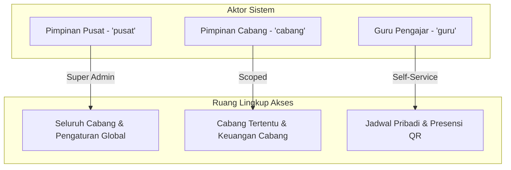
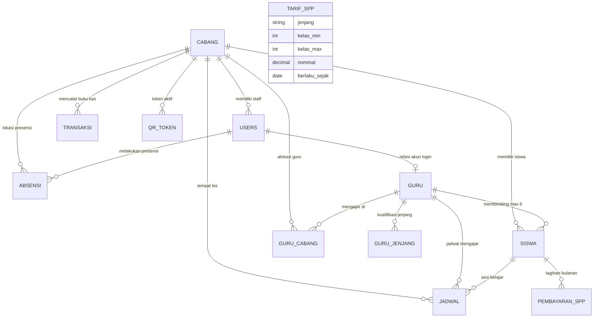

# Spesifikasi Konsep & Arsitektur: Sistem Manajemen Tempat Les (Multi-Cabang)

Dokumen ini adalah acuan resmi (*source of truth*) konsep bisnis, arsitektur data, aturan validasi, dan alur kerja untuk implementasi ulang pada proyek **Laravel Fullstack**.

---

## 1. Ikhtisar Sistem & Visi Bisnis

Sistem Manajemen Tempat Les Multi-Cabang dirancang untuk mengelola operasional lembaga bimbingan belajar/kursus privat yang memiliki banyak cabang fisik, puluhan guru, dan ratusan siswa. Sistem berfokus pada:
1. **Struktur Multi-Cabang Tersentralisasi:** Pimpinan Pusat mengontrol tarif global dan cabang, sedangkan Pimpinan Cabang mengelola operasional harian cabang masing-masing.
2. **Kualitas Pengajaran Privat (Rasio Ketat):** Membatasi beban guru maksimal **6 siswa aktif** di seluruh cabang.
3. **Otomasi Keuangan & Penagihan:** Pembuatan tagihan SPP bulanan otomatis yang idempoten, pencatatan kas otomatis saat pendaftaran, serta penerbitan kwitansi digital via PDF & WhatsApp.
4. **Presensi Guru Berbasis QR Dinamis:** Mencegah kecurangan absensi dengan token QR berumur pendek di lokasi cabang.

---

## 2. Aktor & Matriks Hak Akses (RBAC)

Sistem memiliki 3 tingkatan peran (*role*):



### A. Pimpinan Pusat (`pusat`)
- Akses penuh ke seluruh cabang (`cabang_id = NULL`).
- **Kelola Cabang:** Buat cabang baru (otomatis membuat akun login pimpinan cabang), edit, aktif/nonaktifkan, hapus cabang.
- **Master Tarif SPP:** Menentukan tarif SPP per jenjang (`TK`, `SD`, `SMP`, `SMA_SMK`) dan batas kelas yang berlaku global.
- **Master Biaya Pendaftaran:** Mengatur tarif baku pendaftaran baru.
- **Monitoring Global:** Melihat agregasi pendapatan seluruh cabang, total siswa aktif, dan utilisasi kapasitas guru.
- **Promosi Akun:** Mengubah akun guru biasa menjadi Pimpinan Cabang.

### B. Pimpinan Cabang (`cabang`)
- Terikat pada 1 cabang (`cabang_id` spesifik). Data siswa, transaksi, dan jadwal terisolasi per cabang.
- **Pendaftaran Siswa:** Mendaftarkan siswa (manual / import Excel), input diskon pendaftaran, otomatis generate tagihan bulan berjalan dan jurnal kas masuk.
- **Distribusi Siswa ke Guru:**
  - Penugasan manual dengan validasi kesesuaian jenjang dan kuota slot.
  - **Auto-Assign (1-Klik):** Algoritma load-balancing otomatis untuk siswa belum berguru.
  - **Batch Assign:** Memilih banyak siswa sekaligus untuk ditugaskan ke 1 guru.
- **Manajemen Guru Cabang:** Menghubungkan guru ke cabang, mengatur jadwal mengajar, dan memantau status slot.
- **Keuangan Cabang:**
  - Mencatat pelunasan SPP & menerbitkan nomor kwitansi resmi.
  - Mengunduh kwitansi PDF & mengirim tautan pesan kwitansi via WhatsApp ortu.
  - Menginput pengeluaran (gaji guru, sewa, listrik, modul) & pemasukan lain.
  - Rekapitulasi Laba/Rugi bulanan cabang.
- **Presensi Cabang:** Buka/tutup sesi absensi harian dan menayangkan QR Code dinamis untuk discan oleh guru.

### C. Guru (`guru`)
- Terhubung dengan akun login (`users.id`) dan profil data pengajar (`guru.id`).
- Mengajar di 1 atau beberapa cabang (`guru_cabang`).
- **Jadwal Mengajar:** Kalender mingguan lintas cabang (nama siswa, jenjang, hari, jam, cabang).
- **Presensi Mandiri:** Melakukan scan QR Code cabang via kamera HP/browser untuk mencatat jam datang & jam pulang.
- **Restriksi Privasi:** Guru **TIDAK BISA** melihat data keuangan, nomor telepon orang tua, atau catatan admin cabang.

---

## 3. Diagram Hubungan Entitas (ERD)



---

## 4. Aturan Bisnis Kritis (*Invariants & Rules*)

Aturan berikut **WAJIB** diimplementasikan tanpa kompromi pada backend Laravel:

### 1. Kuota Guru Maksimal 6 Siswa Aktif (Proteksi Race Condition)
- Seorang guru **hanya boleh membimbing maksimal 6 siswa aktif** secara akumulatif di seluruh cabang.
- Siswa berstatus `cuti`, `keluar`, atau yang di-*soft delete* (`deleted_at IS NOT NULL`) tidak dihitung dalam kuota.
- **Implementasi Laravel:**
  ```php
  DB::transaction(function () use ($guruId, $siswaId) {
      $currentCount = Siswa::where('guru_id', $guruId)
          ->whereNull('deleted_at')
          ->where('status', 'aktif')
          ->lockForUpdate()
          ->count();

      if ($currentCount >= 6) {
          throw new Exception("Kapasitas guru telah penuh (Maksimal 6 siswa).");
      }

      Siswa::where('id', $siswaId)->update(['guru_id' => $guruId]);
  });
  ```

### 2. Kompatibilitas Jenjang Pendidikan
- Jenjang terdiri dari 4 klasifikasi baku:
  - `TK`: Kelas 0
  - `SD`: Kelas 1 s/d 6
  - `SMP`: Kelas 7 s/d 9
  - `SMA_SMK`: Kelas 10 s/d 12
- Guru memiliki tabel relasi `guru_jenjang` (misal seorang guru bisa mengajar `SD` dan `SMP`).
- Sistem menolak penugasan jika jenjang siswa tidak ada dalam daftar `guru_jenjang` milik guru terkait.

### 3. Deteksi Bentrok Jadwal Mengajar (Lintas Cabang)
- Guru tidak boleh memiliki 2 jadwal yang bertabrakan pada hari dan rentang jam yang sama, meskipun berada di cabang yang berbeda.
- Rumus irisan waktu:
  $$\text{Bentrok} \iff (\text{jam\_mulai\_baru} < \text{jam\_selesai\_lama}) \land (\text{jam\_selesai\_baru} > \text{jam\_mulai\_lama})$$
- Validasi wajib mengecek seluruh cabang tempat guru tersebut mengajar.

### 4. Idempotensi Tagihan SPP Bulanan (Cron Tgl 1 00:05)
- Setiap tanggal 1 dini hari, scheduler membuat tagihan SPP baru untuk bulan tersebut.
- Tagihan berstatus awal `belum_bayar`.
- **Aturan Idempoten:** Jika scheduler dijalankan ulang 2x atau lebih dalam bulan yang sama, tagihan tidak boleh menduplikasi baris data.
- Dilindungi oleh constraint unik database: `UNIQUE(siswa_id, bulan, tahun)`.
- Siswa dengan status `cuti` atau `keluar` dilewati otomatis (tidak dibuatkan tagihan).

### 5. Histori Tarif SPP Bersifat *Forward-Looking*
- Perubahan nominal SPP di master `tarif_spp` hanya berlaku untuk tagihan yang dibuat pada masa mendatang.
- Tagihan masa lalu yang tersimpan di `pembayaran_spp.nominal` tidak boleh berubah nilainya saat tarif master diperbarui.

### 6. Pendaftaran Siswa & Pencatatan Kas Masuk Otomatis
- Biaya pendaftaran default diambil dari `settings` (`kunci = 'biaya_pendaftaran'`, default Rp 100.000).
- Pendaftaran mendukung diskon nominal manual ($0 \le \text{diskon} \le \text{biaya}$).
- Total bayar pendaftaran = $\text{Biaya Pendaftaran} - \text{Diskon}$.
- Saat form pendaftaran disubmit, sistem dalam 1 transaksi:
  1. Menyimpan data siswa ke tabel `siswa`.
  2. Mencatat pemasukan kas cabang di tabel `transaksi` (`tipe='masuk'`, `kategori='Pendaftaran'`).
  3. Menerbitkan tagihan SPP bulan berjalan di tabel `pembayaran_spp` (`status='belum_bayar'`).

### 7. Algoritma Cerdas Auto-Assign (Load-Balancing)
- Fitur 1-klik untuk menugaskan siswa yang belum memiliki guru (`guru_id IS NULL`):
  1. Ambil daftar siswa tanpa guru di cabang tersebut.
  2. Kelompokkan siswa berdasarkan `jenjang`.
  3. Cari guru yang terdaftar di cabang tersebut dan memiliki kualifikasi `jenjang` yang sama.
  4. Hitung sisa kuota masing-masing guru ($6 - \text{jumlah siswa saat ini}$).
  5. Urutkan guru berdasarkan beban terendah (*least-loaded first*).
  6. Pasangkan siswa secara merata hingga kuota guru penuh.

### 8. Presensi QR Berumur Pendek (*Time-based Short-Lived QR*)
- Pimpinan cabang membuka sesi absensi (memilih tipe: `datang` atau `pulang`).
- Sistem men-generate token unik acak (6-10 karakter) berdurasi 15-30 detik ke tabel `qr_token`.
- Token baru secara otomatis menghapus/menggugurkan token lama di cabang tersebut.
- Saat guru men-scan token via kamera browser:
  - Cek apakah token masih berlaku (`expires_at > NOW()`).
  - Cek apakah guru terdaftar di cabang tersebut.
  - Update `absensi.jam_datang` atau `absensi.jam_pulang` pada record absensi hari ini (`UNIQUE(user_id, tanggal)`).

### 9. Soft-Delete Siswa
- Siswa yang dihapus menggunakan soft-delete (`deleted_at`).
- Siswa terhapus tidak muncul di daftar tabel siswa dan tidak dihitung dalam kuota guru.
- Seluruh riwayat transaksi masa lalu dan pembayaran SPP siswa tetap tersimpan untuk akuntabilitas audit keuangan.

### 10. Standar Kwitansi & Format WhatsApp
- Format Nomor Kwitansi Resmi:
  $$\text{KW} / \{\text{KODE\_CABANG}\} / \{\text{TAHUN}\} / \{\text{BULAN\_2\_DIGIT}\} / \{\text{NOMOR\_URUT\_4\_DIGIT}\}$$
  *Contoh:* `KW/CAB01/2026/09/0001`
- Normalisasi Nomor Telepon Orang Tua untuk WhatsApp:
  - Input lokal: `08123456789` $\rightarrow$ Format API: `628123456789`.
  - Tautan kirim: `https://wa.me/628123456789?text=...`
  - Klik kirim mencatat timestamp `dikirim_at` pada tabel `pembayaran_spp`.

---

## 5. Kamus Data & Relasi Database

### 1. `cabang`
| Kolom | Tipe | Keterangan |
|---|---|---|
| `id` | `VARCHAR(36)` | Primary Key (UUID) |
| `nama` | `VARCHAR(150)` | Nama cabang (cth: "Cabang Jakarta Selatan") |
| `alamat` | `TEXT` | Alamat fisik cabang |
| `status` | `ENUM('aktif','nonaktif')` | Status operasional |
| `created_at` | `DATETIME` | Waktu dibuat |

### 2. `users`
| Kolom | Tipe | Keterangan |
|---|---|---|
| `id` | `VARCHAR(36)` | Primary Key (UUID) |
| `nama` | `VARCHAR(150)` | Nama lengkap |
| `email` | `VARCHAR(190)` | Unik, untuk login |
| `no_pegawai` | `VARCHAR(50)` | NIP / No Pegawai (opsional) |
| `tanggal_lahir` | `DATE` | Tanggal lahir (opsional) |
| `password` | `VARCHAR(255)` | Hash bcrypt |
| `role` | `ENUM('pusat','cabang','guru')` | Peran hak akses |
| `cabang_id` | `VARCHAR(36)` | Foreign Key ke `cabang.id` (NULL jika pusat/guru) |
| `is_active` | `TINYINT(1)` | Status aktif (1=aktif, 0=suspend) |
| `created_at` | `DATETIME` | Waktu dibuat |

### 3. `guru`
| Kolom | Tipe | Keterangan |
|---|---|---|
| `id` | `VARCHAR(36)` | Primary Key (UUID) |
| `user_id` | `VARCHAR(36)` | Foreign Key ke `users.id` (ON DELETE SET NULL) |
| `nama` | `VARCHAR(150)` | Nama guru |
| `email` | `VARCHAR(190)` | Email |
| `no_telp` | `VARCHAR(30)` | Nomor WhatsApp |
| `no_pegawai` | `VARCHAR(50)` | NIP Guru |
| `tanggal_lahir` | `DATE` | Tanggal lahir |
| `alamat` | `TEXT` | Domisili |
| `jenjang` | `ENUM('TK','SD','SMP','SMA_SMK')` | Jenjang utama |
| `is_active` | `TINYINT(1)` | 1 = aktif |

### 4. `guru_cabang` (Pivot Many-to-Many)
- `guru_id VARCHAR(36)` (FK ke `guru.id` CASCADE)
- `cabang_id VARCHAR(36)` (FK ke `cabang.id` CASCADE)
- `PRIMARY KEY (guru_id, cabang_id)`

### 5. `guru_jenjang` (Pivot Kualifikasi)
- `guru_id VARCHAR(36)` (FK ke `guru.id` CASCADE)
- `jenjang ENUM('TK','SD','SMP','SMA_SMK')`
- `PRIMARY KEY (guru_id, jenjang)`

### 6. `siswa`
| Kolom | Tipe | Keterangan |
|---|---|---|
| `id` | `VARCHAR(36)` | Primary Key (UUID) |
| `cabang_id` | `VARCHAR(36)` | FK ke `cabang.id` CASCADE |
| `nama` | `VARCHAR(150)` | Nama lengkap siswa |
| `tempat_lahir` | `VARCHAR(100)` | Tempat lahir |
| `tanggal_lahir` | `DATE` | Tanggal lahir |
| `alamat` | `TEXT` | Alamat rumah |
| `nama_ibu` | `VARCHAR(150)` | Nama orang tua / wali |
| `no_telp_ortu` | `VARCHAR(30)` | No WA ortu untuk pengiriman kwitansi |
| `jenjang` | `ENUM('TK','SD','SMP','SMA_SMK')` | Jenjang pendidikan |
| `kelas` | `TINYINT` | 0 (TK), 1-6 (SD), 7-9 (SMP), 10-12 (SMA/SMK) |
| `guru_id` | `VARCHAR(36)` | FK ke `guru.id` SET NULL (Guru pembimbing) |
| `status` | `ENUM('aktif','cuti','keluar')` | Default 'aktif' |
| `created_at` | `DATETIME` | Waktu registrasi |
| `deleted_at` | `DATETIME` | Soft delete timestamp |

### 7. `tarif_spp`
| Kolom | Tipe | Keterangan |
|---|---|---|
| `id` | `VARCHAR(36)` | Primary Key |
| `jenjang` | `ENUM('TK','SD','SMP','SMA_SMK')` | Jenjang target |
| `kelas_min` | `TINYINT` | Rentang kelas bawah (cth: 1) |
| `kelas_max` | `TINYINT` | Rentang kelas atas (cth: 3) |
| `nominal` | `DECIMAL(12,2)` | Tarif bulanan (cth: 150000.00) |
| `berlaku_sejak`| `DATE` | Tanggal mulai efektif |

### 8. `pembayaran_spp`
| Kolom | Tipe | Keterangan |
|---|---|---|
| `id` | `VARCHAR(36)` | Primary Key |
| `siswa_id` | `VARCHAR(36)` | FK ke `siswa.id` CASCADE |
| `cabang_id` | `VARCHAR(36)` | FK ke `cabang.id` CASCADE |
| `bulan` | `TINYINT` | 1 s/d 12 |
| `tahun` | `SMALLINT` | Tahun (cth: 2026) |
| `nominal` | `DECIMAL(12,2)` | Tagihan SPP riil |
| `status` | `ENUM('belum_bayar','lunas')` | Status pelunasan |
| `nama_pembayar`| `VARCHAR(150)` | Nama yang menyetor |
| `tanggal_bayar`| `DATE` | Tanggal transaksi pelunasan |
| `no_kwitansi` | `VARCHAR(60)` | Nomor kwitansi tercetak |
| `dikirim_at` | `DATETIME` | Timestamp pengiriman WA |
| `created_at` | `DATETIME` | Waktu dibuat |
| **Constraint** | `UNIQUE` | `UNIQUE(siswa_id, bulan, tahun)` |

### 9. `transaksi` (Buku Kas Cabang)
| Kolom | Tipe | Keterangan |
|---|---|---|
| `id` | `VARCHAR(36)` | Primary Key |
| `cabang_id` | `VARCHAR(36)` | FK ke `cabang.id` CASCADE |
| `tipe` | `ENUM('masuk','keluar')` | Debit / Kredit |
| `kategori` | `VARCHAR(80)` | SPP, Pendaftaran, Gaji Guru, Sewa, Listrik |
| `nominal` | `DECIMAL(12,2)` | Nilai transaksi |
| `keterangan` | `TEXT` | Rincian transaksi |
| `tanggal` | `DATE` | Tanggal transaksi |
| `referensi_id`| `VARCHAR(36)` | ID tagihan SPP / pendaftaran terkait |

### 10. `jadwal`
| Kolom | Tipe | Keterangan |
|---|---|---|
| `id` | `VARCHAR(36)` | Primary Key |
| `guru_id` | `VARCHAR(36)` | FK ke `guru.id` CASCADE |
| `siswa_id` | `VARCHAR(36)` | FK ke `siswa.id` CASCADE |
| `cabang_id` | `VARCHAR(36)` | FK ke `cabang.id` CASCADE |
| `hari` | `ENUM('Senin'..'Sabtu')`| Hari les |
| `jam_mulai` | `TIME` | Waktu mulai (cth: 14:00:00) |
| `jam_selesai`| `TIME` | Waktu selesai (cth: 15:30:00) |

### 11. `absensi`
| Kolom | Tipe | Keterangan |
|---|---|---|
| `id` | `VARCHAR(36)` | Primary Key |
| `user_id` | `VARCHAR(36)` | FK ke `users.id` CASCADE |
| `cabang_id` | `VARCHAR(36)` | FK ke `cabang.id` CASCADE |
| `tanggal` | `DATE` | Tanggal presensi |
| `jam_datang` | `DATETIME` | Waktu scan masuk |
| `jam_pulang` | `DATETIME` | Waktu scan pulang |
| **Constraint** | `UNIQUE` | `UNIQUE(user_id, tanggal)` |

### 12. `qr_token`
| Kolom | Tipe | Keterangan |
|---|---|---|
| `token` | `VARCHAR(20)` | Token acak (Primary Key) |
| `cabang_id` | `VARCHAR(36)` | FK ke `cabang.id` CASCADE |
| `tipe` | `ENUM('datang','pulang')`| Tipe presensi |
| `expires_at` | `DATETIME` | Batas waktu kedaluwarsa |
| `created_at` | `DATETIME` | Waktu dibuat |

---

## 6. Arsitektur Komponen Laravel Fullstack (Livewire + Blade)

```text
app/
├── Console/
│   └── Commands/
│       └── GenerateMonthlySppBilling.php  # Cron tanggal 1 jam 00:05
├── Http/
│   └── Middleware/
│       └── EnsureUserRole.php             # Proteksi role 'pusat', 'cabang', 'guru'
├── Livewire/
│   ├── Auth/
│   │   └── Login.php                      # Form login & session handling
│   ├── Pusat/
│   │   ├── Dashboard.php                  # Statistik global
│   │   ├── CabangManager.php              # CRUD cabang
│   │   ├── TarifManager.php               # Kelola tarif SPP & setting pendaftaran
│   │   └── GuruOverview.php               # Monitoring slot guru seluruh cabang
│   ├── Cabang/
│   │   ├── Dashboard.php                  # KPI cabang, grafik keuangan & siswa
│   │   ├── Siswa/
│   │   │   ├── DaftarSiswa.php            # Tabel, filter, soft delete
│   │   │   ├── RegistrasiSiswa.php        # Form pendaftaran + diskon
│   │   │   ├── ImportExcelSiswa.php       # Maatwebsite Excel import & parser
│   │   │   └── AssignGuruModal.php        # Manual assign, auto-assign, batch assign
│   │   ├── Guru/
│   │   │   ├── DaftarGuru.php             # Tabel guru cabang & kuota slot
│   │   │   └── JadwalManager.php          # Jadwal & pencegahan bentrok
│   │   ├── Keuangan/
│   │   │   ├── DaftarTagihanSpp.php       # Filter SPP belum bayar / lunas
│   │   │   ├── BayarSppModal.php          # Form pelunasan & cetak kwitansi
│   │   │   ├── KasTransaksi.php           # Catat pengeluaran & pemasukan
│   │   │   └── LaporanLabaRugi.php        # Ekspor Excel / PDF (DomPDF)
│   │   └── Presensi/
│   │       └── QrDisplay.php              # Live polling token QR per 15 detik
│   └── Guru/
│       ├── JadwalSaya.php                 # Tampilan jadwal mingguan guru
│       └── PresensiScan.php               # HTML5 QR Scanner kamera browser
└── Models/
    ├── Cabang.php
    ├── User.php
    ├── Guru.php
    ├── Siswa.php
    ├── PembayaranSpp.php
    ├── TarifSpp.php
    ├── Transaksi.php
    ├── Jadwal.php
    ├── Absensi.php
    └── QrToken.php
```

---

## 7. Perilaku Khusus & Edge Cases

1. **Format Excel Siswa:**
   - Kolom yang dibaca: `Nama`, `Kelas`, `Tempat Lahir`, `Tanggal Lahir`, `No WA Ortu`, `Alamat`, `Nama Ibu`, `Diskon`.
   - Konversi otomatis nilai kolom `Kelas`:
     - Angka `0` $\rightarrow$ Jenjang `TK`.
     - Angka `1` s/d `6` $\rightarrow$ Jenjang `SD`.
     - Angka `7` s/d `9` $\rightarrow$ Jenjang `SMP`.
     - Angka `10` s/d `12` $\rightarrow$ Jenjang `SMA_SMK`.
2. **Kenaikan Kelas Massal:**
   - Fitur akhir tahun ajaran: Semua siswa aktif naik 1 tingkat (`kelas = kelas + 1`).
   - Siswa kelas 12 yang naik kelas otomatis diubah statusnya menjadi `keluar` (lulus).
3. **Format Tanggal Transaksi:**
   - Seluruh tanggal pembayaran dan pencatatan menggunakan zona waktu lokal Indonesia (`Asia/Jakarta`, UTC+7).

