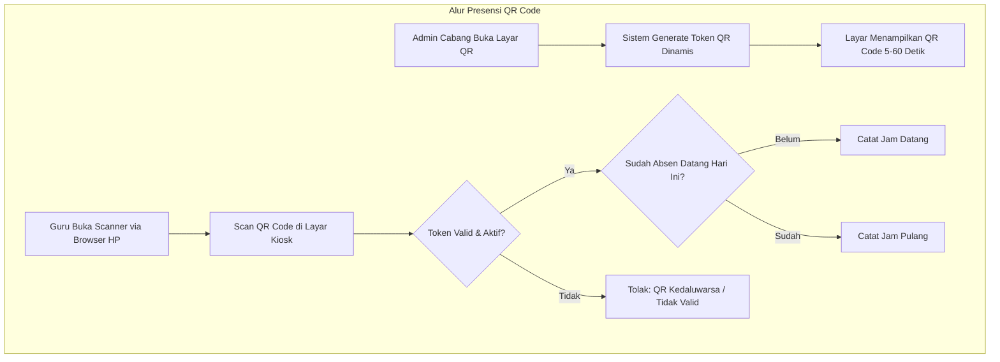
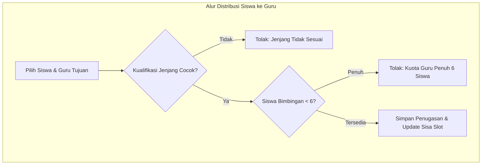

# SIMANLES — Sistem Informasi Manajemen Les

**Rancang Bangun Sistem Informasi Manajemen Terpadu Lembaga Bimbingan Belajar (LKP Sang Siroju Lillah)**  
*Capstone Project — Program Studi Teknik Informatika, Institut Teknologi Adhi Tama Surabaya (ITATS) 2026*

[](https://laravel.com)
[](https://php.net)
[](https://livewire.laravel.com)
[](https://tailwindcss.com)
[](#lisensi)

Aplikasi web berbasis Laravel untuk mengelola operasional lembaga bimbingan belajar (bimbel) multi-cabang — mencakup pendaftaran siswa, distribusi kuota guru, penjadwalan sesi, presensi QR dinamis, penagihan SPP idempoten, pembukuan kas cabang, hingga pengawasan terpusat oleh Admin Pusat.

Repository: [https://github.com/imismaindra/SIMANLES](https://github.com/imismaindra/SIMANLES)

---

## Tim Penyusun & Pengembang (Kelompok 1)

| Nama Mahasiswa | NPM | Peran / Fokus |
|---|---|---|
| **Hasan Abdul Latif** | `06.2023.1.07669` | Developer |
| **Maulana Damar Restu Aji** | `06.2023.1.07690` | Developer |
| **Ahmad Maulana Ismaindra** | `06.2023.1.07659` | Lead Developer / QA |
| **Candra Purnawirawan** | `06.2023.1.07719` | Developer |

**Dosen Pembimbing:** Nanang Fakhrur Rozi, S.ST., M.Kom  
**Institusi:** Program Studi Teknik Informatika, Fakultas Teknologi Elektro dan Rekayasa Jaringan, Institut Teknologi Adhi Tama Surabaya (2026)

---

## Daftar Isi

- [Gambaran Umum, Ruang Lingkup & Batasan](#gambaran-umum-ruang-lingkup--batasan)
- [Peran Pengguna & Hak Akses](#peran-pengguna--hak-akses)
- [Kebutuhan Fungsional (SRS)](#kebutuhan-fungsional-srs)
- [Kebutuhan Nonfungsional (KNF)](#kebutuhan-nonfungsional-knf)
- [Alur Aktivitas Utama (Workflows)](#alur-aktivitas-utama-workflows)
- [Tech Stack & Arsitektur](#tech-stack--arsitektur)
- [Skema Database](#skema-database)
- [Prasyarat Sistem](#prasyarat-sistem)
- [Instalasi & Setup](#instalasi--setup)
- [Akun Demo](#akun-demo)
- [Menjalankan Aplikasi](#menjalankan-aplikasi)
- [Rencana & Skenario Pengujian (TC)](#rencana--skenario-pengujian-tc)
- [Struktur Direktori Proyek](#struktur-direktori-proyek)
- [Lisensi](#lisensi)

---

## Gambaran Umum, Ruang Lingkup & Batasan

SIMANLES dirancang untuk mengatasi kerumitan operasional pencatatan manual pada **LKP Sang Siroju Lillah** yang mengelola banyak cabang, puluhan guru lintas jenjang pendidikan, serta ratusan siswa aktif. Seluruh data operasional diintegrasikan ke dalam satu platform terpusat.

```
Admin Pusat  →  Memantau performa, keuangan, dan pengaturan seluruh cabang
Admin Cabang →  Mengelola operasional harian cabang (siswa, guru, SPP, kas)
Guru         →  Akses mobile: lihat jadwal, bimbingan, rekap, & presensi QR Code
```

### 1. Ruang Lingkup (Scope)
- **Dalam Lingkup (In-Scope):**
  - Manajemen multi-cabang dengan isolasi data per cabang.
  - Pengelolaan data siswa (data diri, jenjang TK/SD/SMP/SMA, status aktif/cuti/keluar, kenaikan kelas massal, soft-delete).
  - Manajemen guru (kualifikasi jenjang, keterkaitan multi-cabang, distribusi bimbingan, validasi kuota).
  - Penjadwalan sesi mengajar dengan pencegahan jadwal bentrok antar-cabang.
  - Presensi mandiri guru menggunakan QR Code dinamis berbasis waktu (time-based rotating token).
  - Penagihan SPP bulanan otomatis berkonsep idempoten, penerbitan kwitansi resmi, dan notifikasi WhatsApp.
  - Pembukuan kas cabang (masuk/keluar) serta laporan laba rugi bulanan.
  - Dashboard analitik untuk Admin Pusat dan Admin Cabang.

- **Di Luar Lingkup (Out-of-Scope):**
  - Aplikasi native Android/iOS (seluruh antarmuka guru berbasis web mobile responsive).
  - Payment gateway otomatis (pembayaran SPP dicatat manual oleh admin kasir cabang).
  - Penilaian rapor/akademik belajar siswa.

### 2. Asumsi & Batasan Sistem
1. Setiap cabang memiliki perangkat (laptop/PC) dan koneksi internet stabil.
2. Guru mengakses modul presensi dan jadwal menggunakan web browser smartphone tanpa aplikasi native tambahan.
3. Kapasitas bimbingan maksimal seorang guru dibatasi **6 siswa**.
4. Periode waktu riset dan pengembangan dibatasi dalam satu semester perkuliahan (Capstone Project).

---

## Peran Pengguna & Hak Akses

Sistem mengimplementasikan otorisasi berbasis peran (*Role-Based Access Control*):

| Menu / Fitur | Admin Pusat (`pusat`) | Admin Cabang (`cabang`) | Guru (`guru`) |
|---|:---:|:---:|:---:|
| **Dashboard** — Ringkasan semua cabang | ✅ | ❌ | ❌ |
| **Dashboard** — Ringkasan cabang sendiri | ✅ | ✅ | ❌ |
| **Siswa** — Lihat & filter daftar | ✅ (Semua) | ✅ (Cabang) | ❌ |
| **Siswa** — Tambah / edit / soft delete | ✅ | ✅ | ❌ |
| **Siswa** — Kenaikan kelas massal | ✅ | ✅ | ❌ |
| **Guru** — Kelola data & kualifikasi jenjang | ✅ | ✅ | ❌ |
| **Guru** — Assign / unassign / auto-assign | ✅ | ✅ | ❌ |
| **Guru** — Lihat daftar siswa bimbingan | ✅ | ✅ | ✅ (Bimbingan sendiri) |
| **Jadwal** — Atur sesi mengajar (anti-bentrok) | ✅ | ✅ | ❌ |
| **Jadwal** — Lihat jadwal mingguan via HP | ✅ | ✅ | ✅ (Jadwal sendiri) |
| **Presensi** — Tampilkan monitor kiosk QR Code | ✅ | ✅ | ❌ |
| **Presensi** — Scan QR Code mandiri via HP | ❌ | ❌ | ✅ |
| **Presensi** — Riwayat absen & rekap bulanan | ✅ | ✅ | ✅ (Absensi sendiri) |
| **SPP** — Generate tagihan bulanan | ✅ | ✅ | ❌ |
| **SPP** — Pelunasan, cetak kwitansi & WA | ✅ | ✅ | ❌ |
| **Kas** — Catat transaksi masuk / keluar | ✅ | ✅ | ❌ |
| **Kas** — Laporan laba rugi cabang | ✅ (Semua cabang) | ✅ (Cabang sendiri) | ❌ |
| **Pengaturan** — Tarif SPP & Biaya Pendaftaran | ✅ | ❌ | ❌ |
| **Pengaturan** — Tambah / nonaktifkan cabang | ✅ | ❌ | ❌ |
| **Pengaturan** — Audit log sistem | ✅ | ❌ | ❌ |

---

## Kebutuhan Fungsional (SRS)

Berdasarkan dokumen *Software Requirements Specification* (SRS), kebutuhan dikelompokkan dengan prioritas **MoSCoW** (*Must*, *Should*, *Could*):

| ID | Modul | Deskripsi Kebutuhan | Aktor | Ref | Prioritas |
|---|---|---|---|---|:---:|
| **KF-01** | Autentikasi | Login dan logout dengan email dan password terenkripsi | Semua | PB-01 | **Must** |
| **KF-02** | Autentikasi | Pembatasan menu dan hak akses halaman sesuai peran pengguna | Semua | PB-01 | **Must** |
| **KF-03** | Autentikasi | Pengaturan tarif SPP, biaya, dan cabang hanya dapat diubah Admin Pusat | Pusat | PB-02 | **Must** |
| **KF-04** | Dashboard | Dashboard pusat menampilkan siswa aktif, pendapatan, tunggakan SPP, & utilisasi guru | Pusat | PB-03 | **Must** |
| **KF-05** | Dashboard | Dashboard cabang menampilkan siswa tanpa guru, slot kuota guru, & jadwal harian | Cabang | PB-04 | **Should** |
| **KF-06** | Siswa | Pendaftaran siswa baru (data diri, jenjang, kelas, kontak orang tua) | Cabang | PB-05 | **Must** |
| **KF-07** | Siswa | Pencarian dan filter siswa berdasarkan nama, jenjang, dan status aktif/cuti/keluar | Cabang | PB-06 | **Should** |
| **KF-08** | Siswa | Perubahan status siswa dengan riwayat keuangan tetap utuh (*soft delete*) | Cabang | PB-07 | **Must** |
| **KF-09** | Siswa | Kenaikan kelas massal akhir tahun ajaran (1-klik proses) | Cabang | PB-08 | **Should** |
| **KF-10** | Siswa/Guru | Import data awal siswa dan guru dari file spreadsheet / Excel | Cabang | PB-09 | **Should** |
| **KF-11** | Guru | Pengelolaan profil guru, kualifikasi jenjang, dan relasi multi-cabang | Cabang | PB-10 | **Must** |
| **KF-12** | Guru | Penugasan siswa ke guru dengan validasi kuota maks 6 siswa & kesesuaian jenjang | Cabang | PB-11 | **Must** |
| **KF-13** | Guru | Pembagian otomatis siswa tanpa guru (*auto-assign algorithm*) | Cabang | PB-12 | **Could** |
| **KF-14** | Jadwal | Tambah, ubah, dan hapus jadwal sesi mengajar | Cabang | PB-13 | **Must** |
| **KF-15** | Jadwal | Pencegahan jadwal bentrok untuk guru yang sama (termasuk antar-cabang) | Cabang | PB-14 | **Must** |
| **KF-16** | Jadwal | Guru melihat jadwal bimbingan mingguan melalui smartphone | Guru | PB-15 | **Should** |
| **KF-17** | Presensi | Generate QR Code presensi datang dan pulang yang berganti berkala (*time-based*) | Cabang | PB-16 | **Should** |
| **KF-18** | Presensi | Guru melakukan presensi datang/pulang dengan scan QR via browser HP | Guru | PB-17 | **Should** |
| **KF-19** | Presensi | Rekap kehadiran guru harian, 7 hari terakhir, dan bulanan per cabang | Cabang | PB-18 | **Could** |
| **KF-20** | SPP | Pengaturan matriks master tarif SPP per jenjang dan rentang kelas | Pusat | PB-19 | **Must** |
| **KF-21** | SPP | Generate tagihan SPP bulanan otomatis bersifat idempoten (anti tagihan ganda) | Cabang | PB-20 | **Must** |
| **KF-22** | SPP | Pencatatan pelunasan SPP dengan nomor kwitansi unik otomatis | Cabang | PB-21 | **Must** |
| **KF-23** | SPP | Cetak kwitansi fisik pembayaran SPP siap print | Cabang | PB-22 | **Should** |
| **KF-24** | SPP | Pengiriman link bukti bayar kwitansi ke WhatsApp orang tua siswa | Cabang | PB-23 | **Should** |
| **KF-25** | SPP | Laporan daftar siswa menunggak tagihan SPP | Cabang | PB-24 | **Must** |
| **KF-26** | Kas | Pencatatan transaksi kas masuk dan kas keluar per kategori operasional | Cabang | PB-25 | **Must** |
| **KF-27** | Kas | Laporan laba rugi dan mutasi kas bulanan cabang & konsolidasi pusat | Cabang, Pusat | PB-26 | **Must** |
| **KF-28** | Pengaturan | Penambahan cabang baru (nama, kode unik, alamat) dan penonaktifan cabang | Pusat | PB-27 | **Should** |
| **KF-29** | Pengaturan | Pengelolaan biaya pendaftaran siswa baru dan konfigurasi diskon/promo | Cabang | PB-28 | **Could** |
| **KF-30** | Keamanan | Audit trail / log perubahan data sensitif (tarif, cabang, koreksi transaksi) | Pusat | PB-29 | **Should** |
| **KF-31** | Presensi | Guru melihat histori absensi mandiri (tanggal, jam datang, jam pulang) | Guru | - | **Should** |
| **KF-32** | Guru | Guru melihat daftar nama siswa yang berada di bawah bimbingannya | Guru | - | **Should** |
| **KF-33** | Presensi | Guru melihat total kehadiran dan ketidakhadiran per bulan | Guru | - | **Should** |

---

## Kebutuhan Nonfungsional (KNF)

| ID | Kategori | Spesifikasi & Kriteria Penerimaan |
|---|---|---|
| **KNF-01** | **Keamanan Data** | Password dienkripsi dengan algoritma hash kuat (*Bcrypt*), otorisasi diverifikasi di sisi server (*server-side gate*), dan isolasi ketat data antar cabang. |
| **KNF-02** | **Akses Finansial** | Data keuangan (SPP & buku kas) hanya dapat diakses oleh Admin Pusat dan Admin Cabang. Akun Guru diblokir total dari seluruh modul finansial. |
| **KNF-03** | **Kinerja Sistem** | Waktu render halaman utama (*load time*) di bawah **3 detik** pada kondisi dataset benchmark (~80 siswa aktif, 12 guru). |
| **KNF-04** | **Usabilitas (UX)** | Seluruh antarmuka disajikan dalam Bahasa Indonesia dengan alur navigasi ergonomis bagi operator bimbel. |
| **KNF-05** | **Aksesibilitas Mobile** | Antarmuka khusus guru (jadwal, scan scanner QR, daftar siswa, rekap absen) dirancang responsif dan nyaman digunakan pada layar *smartphone*. |
| **KNF-06** | **Kompatibilitas** | Aplikasi teruji kompatibel penuh pada browser web standar terkini (*Google Chrome*, *Microsoft Edge*, *Mozilla Firefox*, dan *Safari Mobile*). |
| **KNF-07** | **Keandalan (Idempotensi)** | Proses generate massal SPP bulanan bersifat *idempotent* (eksekusi ulang pada bulan yang sama tidak akan menduplikasi tagihan siswa). |
| **KNF-08** | **Integritas Data** | Seluruh masukan form divalidasi ketat; penghapusan data siswa menerapkan *soft delete* untuk menjaga integritas histori transaksi keuangan. |
| **KNF-09** | **Maintainability** | Kode mengikuti standar arsitektur *Service-Layer Pattern*, dilengkapi suite pengujian otomatis (*automated test coverage*), dan dokumentasi instalasi lengkap. |
| **KNF-10** | **Ketersediaan** | Basis data produksi mendukung mekanisme pencadangan (*automated backup*) secara berkala. |

---

## Alur Aktivitas Utama (Workflows)

Merujuk pada *Activity Diagram* spesifikasi sistem:





1. **Monitoring Cabang & Keuangan (Admin Pusat):** Admin Pusat memilih cabang dan rentang periode. Sistem mengagregasi total siswa aktif, sisa kuota guru, rekap transaksi kas, serta tagihan/pelunasan SPP.
2. **Distribusi Siswa (Admin Cabang):** Sistem memvalidasi kesesuaian jenjang guru (TK/SD/SMP/SMA) dan memastikan kuota maksimum 6 siswa/guru belum terlampaui sebelum menyimpan penugasan.
3. **Presensi QR Dinamis (Guru & Cabang):** Layar cabang menampilkan QR token yang ter-refresh otomatis. Guru memindai QR via peramban HP; sistem mencatat jam datang pada pemindaian pertama dan jam pulang pada pemindaian berikutnya di hari yang sama.
4. **Billing & WhatsApp SPP (Admin Cabang):** Tagihan digenerate massal per tanggal 1. Saat orang tua membayar, admin mencatat pelunasan, mencetak kwitansi dengan nomor unik berurutan, dan mengirim rincian pelunasan langsung ke nomor WhatsApp orang tua.

---

## Tech Stack & Arsitektur

| Layer | Teknologi | Keterangan |
|---|---|---|
| **Backend Framework** | Laravel 13 (PHP 8.3+) | Routing, MVC, Eloquent ORM, Middleware RBAC |
| **Reaktivitas UI** | Livewire 4 + Alpine.js | Komponen reaktif real-time tanpa SPA overload |
| **Frontend Styling** | Tailwind CSS + Vite | Desain antarmuka responsif (desktop kiosk & mobile phone) |
| **Basis Data** | SQLite (Dev/Testing) & MySQL 8.x (Prod) | Relasional ACID-compliant |
| **Library QR Code** | `simplesoftwareio/simple-qrcode` | Generator QR Code time-based dinamis |
| **PDF & Kwitansi** | `barryvdh/laravel-dompdf` | Engine rendering slip kwitansi resmi |
| **Visualisasi / Chart** | `arielmejiadev/larapex-charts` | Grafik tren keuangan & kehadiran di dashboard |
| **Icon Set** | `mallardduck/blade-lucide-icons` | Ikon antarmuka Lucide |
| **Testing Suite** | PHPUnit 12 | Unit & feature testing |

---

## Skema Database

```
users           → Akun pengguna (role: pusat | cabang | guru, encrypted password)
cabang          → Master cabang (nama, kode unik, alamat, status)
guru            → Data profil guru (NIP, nama, kontak, cabang_id)
guru_cabang     → Relasi pivot guru mengajar di multi-cabang
guru_jenjang    → Kualifikasi jenjang guru (TK, SD, SMP, SMA_SMK)
siswa           → Data siswa (NIS, data diri, ortu, jenjang, kelas, status, soft-deleted)
tarif_spp       → Master tarif SPP per jenjang dan rentang kelas
pembayaran_spp  → Tagihan bulanan, status lunas/menunggak, kwitansi, nomor WA
transaksi       → Buku kas cabang (kategori, nominal, tipe masuk/keluar)
jadwal          → Sesi mengajar terjadwal (guru, siswa, waktu mulai/selesai)
absensi         → Rekam kehadiran guru (tanggal, jam datang, jam pulang)
qr_token        → Token QR sementara berumur pendek (time-based dynamic token)
settings        → Parameter global sistem (biaya pendaftaran, nama instansi)
```

---

## Prasyarat Sistem

- **PHP** >= 8.3 dengan ekstensi: `pdo`, `mbstring`, `openssl`, `xml`, `ctype`, `json`, `sqlite3` / `pdo_mysql`, `gd` (untuk QR code)
- **Composer** >= 2.2
- **Node.js** >= 18.x & npm
- **Web Server:** Nginx / Apache / `php artisan serve`

---

## Instalasi & Setup

### 1. Clone Repositori
```bash
git clone https://github.com/imismaindra/SIMANLES.git simanles
cd simanles
```

### 2. Setup Otomatis (Recommended)
Perintah berikut menginstal paket composer & npm, menyiapkan `.env`, generate app key, menjalankan migrasi database, dan build frontend:
```bash
composer run setup
```

### 3. Setup Manual (Alternatif)
```bash
# Salin konfigurasi environment
cp .env.example .env

# Pasang dependensi backend & frontend
composer install
npm install

# Generate application key
php artisan key:generate

# Migrasi tabel database
php artisan migrate

# Build berkas aset Vite
npm run build
```

### 4. Mengisi Data Awal (Demo Seeder)
Isi database dengan data realistis LKP Sang Siroju Lillah (cabang, guru lintas jenjang, 80+ siswa, tarif, dan histori kas):
```bash
php artisan db:seed --class=SimanlesSeeder
```

---

## Akun Demo

| Peran | Alamat Email | Password Default | Akses Lingkup |
|---|---|---|---|
| **Admin Pusat** | `admin@lespintar.id` | `admin123` | Semua cabang & menu pengaturan |
| **Admin Cabang 1** | `cabang.ponokawan@lespintar.id` | `cabang123` | Cabang Ponokawan |
| **Admin Cabang 2** | `cabang.jaksel@lespintar.id` | `cabang123` | Cabang Jakarta Selatan |
| **Guru (Contoh)** | `nip3101@lespintar.id` | Format tanggal lahir: `1995-05-14` | Khusus jadwal, bimbingan, presensi HP |

---

## Menjalankan Aplikasi

### Mode Pengembangan (Development)
Menjalankan HTTP server Laravel, Queue Worker, dan Hot Module Replacement (HMR) Vite secara simultan:
```bash
composer run dev
```
Buka browser di: **http://localhost:8000**

### Scheduler Otomatis (Tagihan SPP Bulanan)
Agar tagihan SPP ter-generate otomatis setiap awal bulan, konfigurasikan cron job server:
```bash
* * * * * cd /path/ke/simanles && php artisan schedule:run >> /dev/null 2>&1
```
Atau jalankan manual via Artisan:
```bash
php artisan spp:generate-monthly
```

---

## Rencana & Skenario Pengujian (TC)

Pengujian dilakukan menggunakan pengujian otomatis (*PHPUnit*), pengujian integrasi antar modul, serta *User Acceptance Testing* (UAT).

### Matriks Skenario Uji Awal (SRS Test Cases)

| ID Uji | Modul | Skenario Pengujian | Hasil yang Diharapkan |
|---|---|---|---|
| **TC-01** | Autentikasi | Login dengan email dan password benar | Berhasil masuk ke dashboard sesuai peran pengguna |
| **TC-02** | Autentikasi | Login dengan password salah | Ditolak dengan pesan kesalahan autentikasi |
| **TC-03** | Hak Akses | Admin Cabang mencoba akses halaman pengaturan tarif | Akses ditolak (*403 Forbidden*) |
| **TC-04** | Siswa | Tambah siswa baru dengan data lengkap | Siswa tersimpan dan tampil pada cabang yang sesuai |
| **TC-05** | Siswa | Simpan siswa dengan kolom wajib dikosongkan | Muncul validasi input, data tidak tersimpan |
| **TC-06** | Guru | Tugaskan siswa ke guru yang sudah memiliki 6 bimbingan | Ditolak, sistem menampilkan peringatan kapasitas penuh |
| **TC-07** | Guru | Tugaskan siswa SD ke guru tanpa kualifikasi jenjang SD | Ditolak, sistem menampilkan peringatan jenjang tidak sesuai |
| **TC-08** | Jadwal | Buat sesi yang bertabrakan dengan jadwal guru yang sama | Ditolak, sistem memberi notifikasi jadwal bentrok |
| **TC-09** | SPP | Eksekusi generate tagihan SPP dua kali pada bulan yang sama | Bersifat idempoten: tidak ada duplikasi tagihan siswa |
| **TC-10** | SPP | Pelunasan tagihan SPP siswa | Status berubah menjadi lunas dan nomor kwitansi unik terbit |
| **TC-11** | SPP | Membayar ulang tagihan yang statusnya sudah lunas | Ditolak oleh sistem |
| **TC-12** | Kas | Mencatat pengeluaran kas dengan nominal 0 atau negatif | Validasi menolak input |
| **TC-13** | Laporan | Komparasi laba rugi dengan mutasi transaksi periode yang sama | Rekapitulasi saldo bersih terbukti sinkron |
| **TC-14** | Presensi | Guru memindai token QR Code yang sudah kedaluwarsa | Presensi ditolak, meminta scan token QR terbaru |
| **TC-15** | Akses Guru | Akun guru mencoba membuka halaman SPP atau Buku Kas | Sistem menolak akses secara langsung |

### Menjalankan Pengujian Otomatis
```bash
# Jalankan seluruh test suite
php artisan test

# Jalankan pengujian logika modul spesifik
php artisan test --filter=SiswaLogicTest
php artisan test --filter=GuruAssignmentLogicTest
php artisan test --filter=JadwalLogicTest
php artisan test --filter=PresensiQrLogicTest
php artisan test --filter=SppAndKasLogicTest
```

### Kriteria Kelulusan Pengujian
1. **100% skenario fitur Must** lulus tanpa cacat (*zero critical bugs*).
2. **Minimal 90% skenario fitur Should** lulus verifikasi.
3. Seluruh alur utama diverifikasi dan disetujui oleh perwakilan mitra LKP Sang Siroju Lillah melalui lembar UAT.

---

## Struktur Direktori Proyek

```
app/
├── Console/Commands/
│   └── GenerateMonthlySppBilling.php   # Scheduler pembuatan SPP otomatis
├── Http/Controllers/
│   ├── AdminDashboardController.php    # Agregasi metrik KPI cabang & pusat
│   ├── GuruController.php              # Pengelolaan guru & distribusi bimbingan
│   ├── JadwalController.php            # Manajemen sesi jadwal & anti-bentrok
│   ├── KasController.php               # Pencatatan transaksi kas & laporan laba rugi
│   ├── PengaturanController.php        # Master tarif, biaya, & cabang
│   ├── PresensiController.php          # Kiosk QR Code & scanner mandiri mobile
│   ├── SiswaController.php             # CRUD siswa, filter, & kenaikan kelas
│   └── SppController.php              # Tagihan SPP, kwitansi, & deep-link WhatsApp
├── Models/
│   ├── Absensi.php                     # Log kehadiran jam datang & pulang
│   ├── Cabang.php                      # Entitas cabang bimbel
│   ├── Guru.php                        # Entitas guru & kualifikasi
│   ├── Jadwal.php                      # Sesi bimbingan belajar
│   ├── PembayaranSpp.php               # Data tagihan & kwitansi SPP
│   ├── QrToken.php                     # Token rotasi presensi QR
│   ├── Setting.php                     # Konfigurasi parameter sistem
│   ├── Siswa.php                       # Data siswa (soft delete enabled)
│   ├── TarifSpp.php                    # Master nominal SPP per jenjang
│   ├── Transaksi.php                   # Mutasi arus kas
│   └── User.php                        # Akun & role pengguna
└── Services/
    ├── CabangContextService.php        # Resolusi cabang aktif multi-tenant
    ├── GuruService.php                 # Logika validasi kuota 6 & jenjang guru
    ├── JadwalService.php               # Deteksi bentrok jadwal
    ├── KasService.php                  # Perhitungan neraca & mutasi kas
    ├── PresensiService.php             # Validasi rotasi token QR dinamis
    ├── SiswaService.php                # Alur registrasi & kenaikan kelas massal
    └── SppService.php                  # Mekanisme idempoten tagihan & kwitansi

database/
├── migrations/                         # Migrasi skema database terpadu
└── seeders/
    └── SimanlesSeeder.php              # Data simulasi lengkap 2 cabang & 80+ siswa

routes/
└── web.php                             # Definisi route web & API internal
```

---

## Lisensi

Aplikasi ini dikembangkan untuk kebutuhan akademik **Capstone Project 2026** oleh Kelompok 1, Program Studi Teknik Informatika, **Institut Teknologi Adhi Tama Surabaya (ITATS)** bekerjasama dengan mitra **LKP Sang Siroju Lillah**.

Hak Cipta © 2026 Tim Capstone ITATS & LKP Sang Siroju Lillah. Seluruh hak cipta dilindungi undang-undang.
